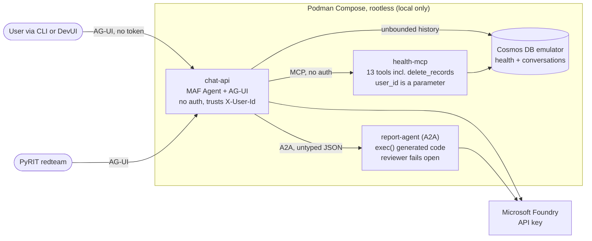
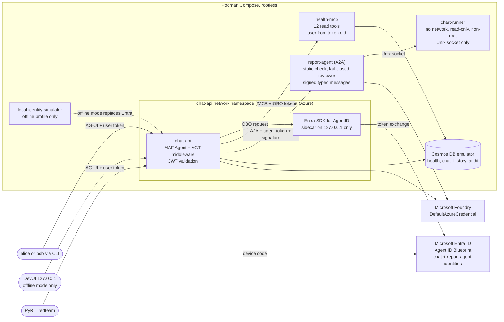
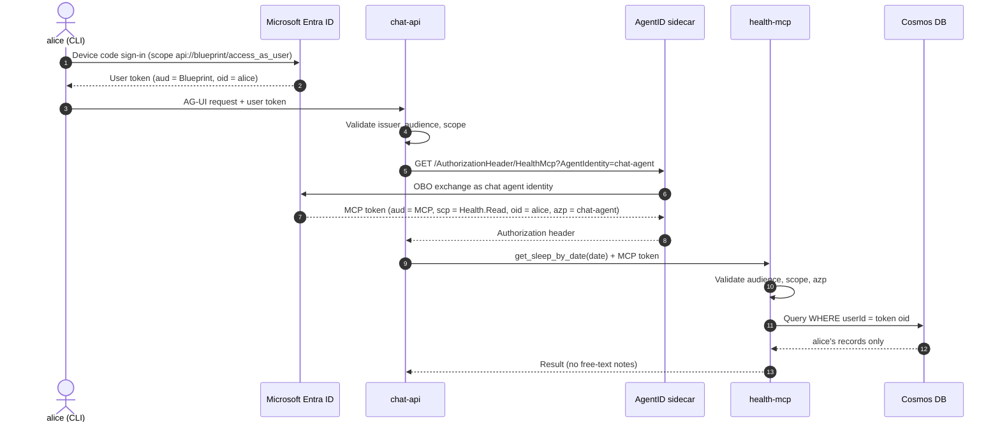
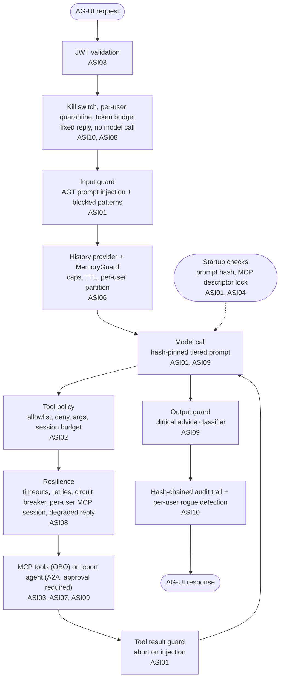
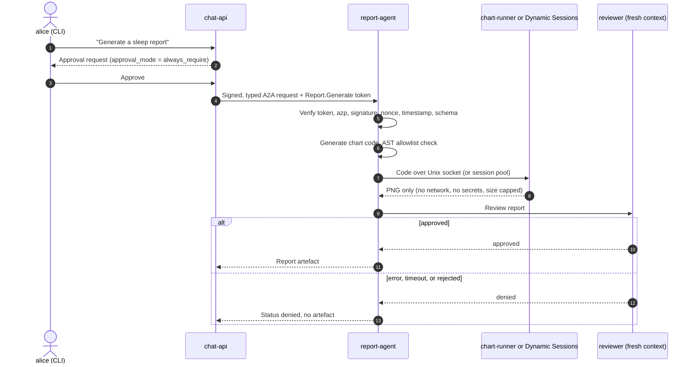
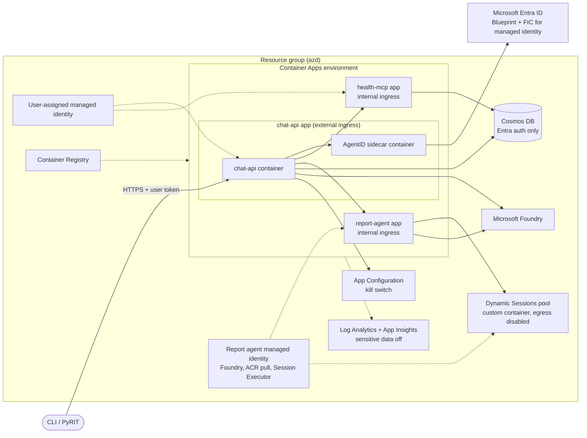

## Overview

The sample is a Python port of the Biotrackr chat agent, shipped as two stacks with the same components and file names:

* `starter/` runs locally only and leaves every OWASP Agentic risk exploitable ([ADR-0003](adr/0003-mirrored-starter-and-solution.md), [ADR-0004](adr/0004-naive-but-plausible-starter.md), [ADR-0005](adr/0005-starter-local-only-solution-on-azure.md))
* `solution/` applies a control for each risk and runs locally or on Azure Container Apps

Both stacks share the seed data, the command-line client, and the PyRIT red-team harness at the repository root.

## Repository layout

```text
.devcontainer/      Optional dev container (Podman); primary workflow is host uv + podman compose
data/seed/          alice and bob health data, poisoned food note, canaries
client/             CLI AG-UI client (--as alice|bob, --target starter|solution-local|solution-azure)
redteam/            PyRIT harness and scorers shared by both stacks
starter/            Insecure stack (Podman Compose only)
solution/           Secured stack (Podman Compose, azd, Bicep)
  policies/         Hash-pinned system prompt, governance YAML, blocked patterns, MCP descriptor lock
  scripts/          Agent ID provisioning and seeding
  infra/            Bicep for Azure Container Apps
docs/adr/           Architecture decision records
```

## Starter components

The starter trusts the model to choose the user, exposes every tool, and runs generated code in-process.



## Solution components (local)

The solution adds identity, an isolated chart runner, and a governed middleware pipeline. The identity simulator runs only under the `offline` profile ([ADR-0018](adr/0018-offline-identity-simulator.md)).



## Identity flow (ASI03)

The MCP server derives the user from the on-behalf-of token, so a hijacked agent cannot request another user's data ([ADR-0013](adr/0013-entra-agent-id-obo.md), [ADR-0014](adr/0014-agent-id-sidecar.md)). The sidecar accepts loopback callers only, so in Compose it shares chat-api's network namespace, the same topology as the Container Apps replica; no other service can reach it.



## Control placement on the request path

Each control sits at a point where it can fail closed ([ADR-0019](adr/0019-fail-closed-control-contract.md)). All agent middleware attaches to the `Agent`, so DevUI and AG-UI are governed identically ([ADR-0012](adr/0012-demo-clients.md)).



## Report generation (ASI05, ASI07, ASI09)

Generated chart code never runs in the report agent process ([ADR-0016](adr/0016-isolated-chart-runner.md)). From `s3-reports`, the A2A request is typed and carries an app-only `Report.Generate` token from the chat agent identity (the sidecar's autonomous route). From `s5-supply-chain`, every request also carries a single-use Ed25519 signature from chat-api over the method, path, body hash, nonce, signing time, and schema version; the report agent checks the token first, then the signature (60 s window, in-process replay cache), then the versioned schema. The private key is held by chat-api only (a Compose volume locally, a Container Apps secret on Azure) and the report agent holds only the public key. Every chat reply also passes the fail-closed output guard ([ADR-0021](adr/0021-output-policy-for-clinical-advice.md)), and an approval resume may only approve or reject, never edit the arguments.



## Azure deployment

Only the chat API has external ingress. The sidecar runs inside the chat API container app and authenticates with a federated credential on the Blueprint ([ADR-0017](adr/0017-live-azure-segment.md)).



## Risk-to-control map

| ASI   | Starter weakness                                    | Solution control                                                           | Live |
|-------|-----------------------------------------------------|----------------------------------------------------------------------------|------|
| ASI01 | Prompt inline, poisoned notes reach the model       | Hash-pinned tiered prompt, input and tool-result screening, notes withheld | Yes  |
| ASI02 | All tools incl. delete, unbounded paging, no budget | Allowlist, deny `*delete*`, argument validation, atomic session budget     | Yes  |
| ASI03 | Model chooses `user_id`, no auth, API keys          | Entra Agent ID OBO, `oid`-scoped queries, `azp` checks, managed identity   | Yes  |
| ASI04 | Unpinned ranges, overridable tool descriptions      | Hash-locked dependencies, MCP descriptor pinning, digest-pinned images, Dependabot, CodeQL, SBOM, `mcp-scan` | No   |
| ASI05 | `exec()` in the report agent                        | AST check plus isolated runner with no network or secrets                  | Yes  |
| ASI06 | Unbounded history, sessions not bound to users      | History caps, TTL, per-user partitions, MemoryGuard                        | No   |
| ASI07 | Unauthenticated untyped A2A                         | Agent ID token, single-use Ed25519 signatures with nonce, timestamp, and body hash, versioned typed schemas | No   |
| ASI08 | No timeouts, outage hangs the agent                 | Timeouts, bounded retries, circuit breaker, graceful degradation           | No   |
| ASI09 | Medical advice allowed, fail-open reviewer          | Output classifier, fail-closed reviewer, approval for reports, disclaimers | Yes  |
| ASI10 | No audit, no kill switch, sensitive telemetry       | Hash-chained audit, rogue detection, kill switch, OTel sensitive data off  | No   |

## Delivery slices

The architecture is built up in vertical slices. Each one ends in a git tag that runs locally and, from S1 onwards, on Azure ([ADR-0023](adr/0023-vertical-slices-with-tagged-checkpoints.md)).

| Tag               | Starter components                      | Solution components added                                | Azure resources added                                                 |
|-------------------|-----------------------------------------|----------------------------------------------------------|-----------------------------------------------------------------------|
| `s0-foundation`   | chat-api, health-mcp, Cosmos emulator   | None                                                     | None                                                                  |
| `s1-identity`     | No change                               | JWT validation, AgentID sidecar, OBO, identity simulator | Container Apps, ACR, managed identity, Cosmos DB, Foundry, monitoring |
| `s2-tools`        | `delete_records`, rug-pull descriptions | Governance policies, input, tool, and tool-result guards | None (`azd deploy`)                                                   |
| `s3-reports`      | report-agent with `exec()`              | report-agent, chart-runner, output guard, approvals      | report-agent app, Dynamic Sessions pool                               |
| `s4-operations`   | No change                               | Memory guard, resilience, kill switch, audit, rogue detection | App Configuration, `chat_history` and `audit` containers         |
| `s5-supply-chain` | No change                               | Signed A2A messages, `a2a-keys` service, CI workflows    | None (`azd up` for the new signing-key parameters)                    |
| `s6-talk-ready`   | No change                               | Demo runbook, saved scorecards, one retry for a cold kill-switch read | None (`azd deploy`)                                      |

## Related documents

* [Architecture decision records](adr/README.md)
* [Demo runbook](demo-runbook.md)
* [Research](research.md)
* [Requirements](requirements.md)
* [Talk abstract](abstract.md)
